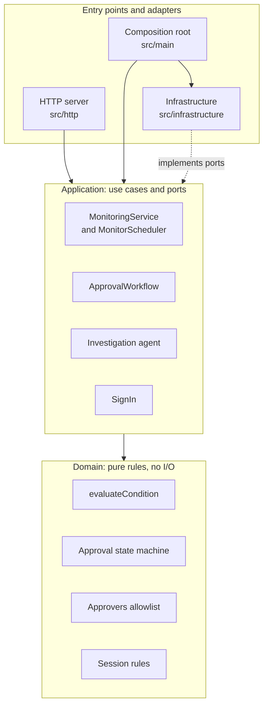
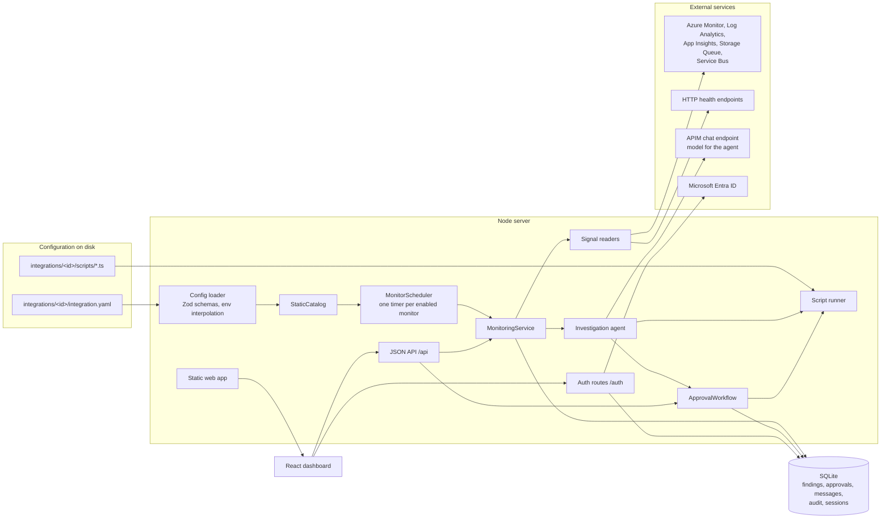
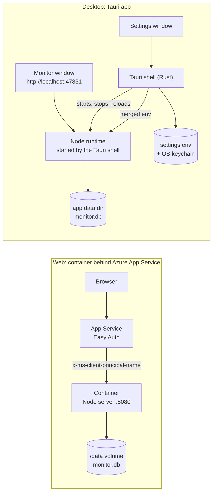
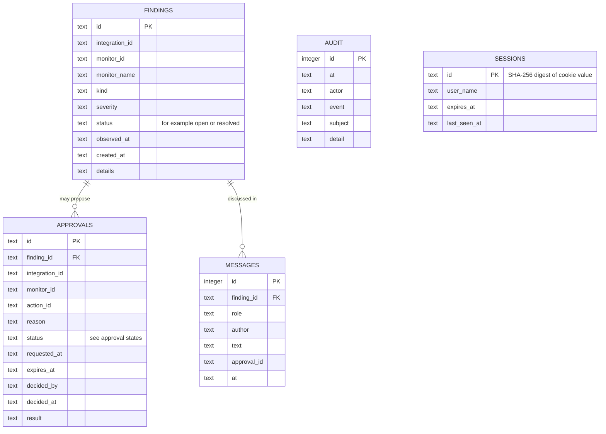

# Architecture

Integration Monitor watches the integrations a company runs, such as APIs, queues and health endpoints. When a monitor detects a problem, an AI agent investigates it with read-only actions and proposes fixes. Nothing changes until a named approver confirms the proposal.

## Layers

The code follows clean architecture. Dependencies point inward: outer layers know about inner ones, never the reverse.

| Layer | Folder | Contents | Depends on |
| --- | --- | --- | --- |
| Domain | `src/domain` | Monitor condition evaluation, approval states, approver rules, session rules, error codes | nothing |
| Application | `src/application` | Monitoring, scheduling, approvals, the investigation agent, sign-in, read models; the ports they need | domain |
| Infrastructure | `src/infrastructure` | Config loader, signal readers, action script runner, APIM chat client, SQLite, Entra and PKCE, system clock | application ports |
| HTTP | `src/http` | JSON API, auth routes, security headers, static web app, rate limiter | application |
| Composition root | `src/main` | Settings from environment, wiring, `serve.ts`, `validate.ts` | everything |

## Components

## Deployment targets

The same server code runs in two wrappers. Only the wrapper and the sign-in mode differ.

- **Web**: App Service authenticates users with Easy Auth and passes the identity in a header. The server must be reachable only through App Service or the gateway.
- **Desktop**: the shell runs the server on `127.0.0.1` and opens the monitor window. Users sign in with Microsoft inside the window, through the server's Entra flow.

## Data model

Five SQLite tables back the application. Each state change writes its audit entry in the same transaction.

The audit table is append-only. Sessions store only the digest of the cookie value, never the cookie itself.

## API

| Method | Path | Who | Purpose |
| --- | --- | --- | --- |
| GET | `/api/whoami` | signed in | the current user and whether they are an approver |
| GET | `/api/integrations` | signed in | integrations and their monitors |
| GET | `/api/monitors`, optionally `?tag=` | signed in | monitor status, filtered by tag |
| GET | `/api/groups` | signed in | groups with their members and open issues |
| POST | `/api/groups` | approvers | create a group (`id`, `name`, `owner`, `description`, `monitors`) |
| POST | `/api/groups/:id/update` | approvers | replace a group's fields and members |
| POST | `/api/groups/:id/delete` | approvers | delete a group; its monitors are not changed |
| GET | `/api/findings`, `/api/findings/:id` | signed in | open issues and their threads |
| POST | `/api/findings/:id/resolve` | approvers | close an issue |
| GET | `/api/audit` | signed in | audit log |
| POST | `/api/approvals/:id/approve` | approvers | run the proposed write once |
| POST | `/api/approvals/:id/reject` | approvers | reject a proposal |
| POST | `/api/approvals/:id/dry-run` | approvers | preview a proposal without approving it |
| GET | `/auth/login`, `/auth/callback` | anyone | Microsoft sign-in |
| POST | `/auth/logout` | signed in | end the session |

Requests from the web app must send JSON, which doubles as the CSRF guard. The auth routes are rate limited per client address.
