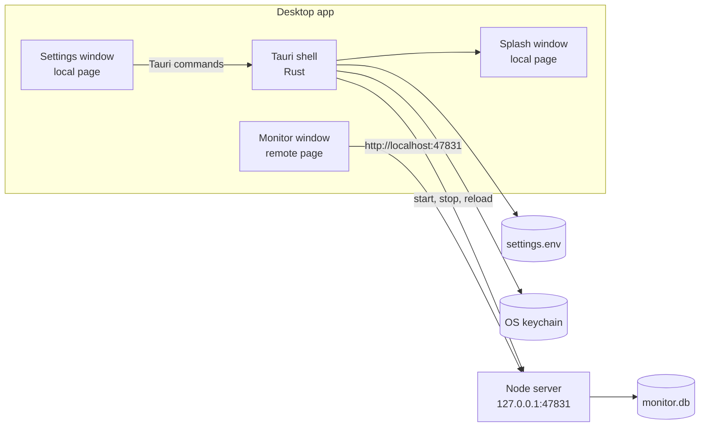
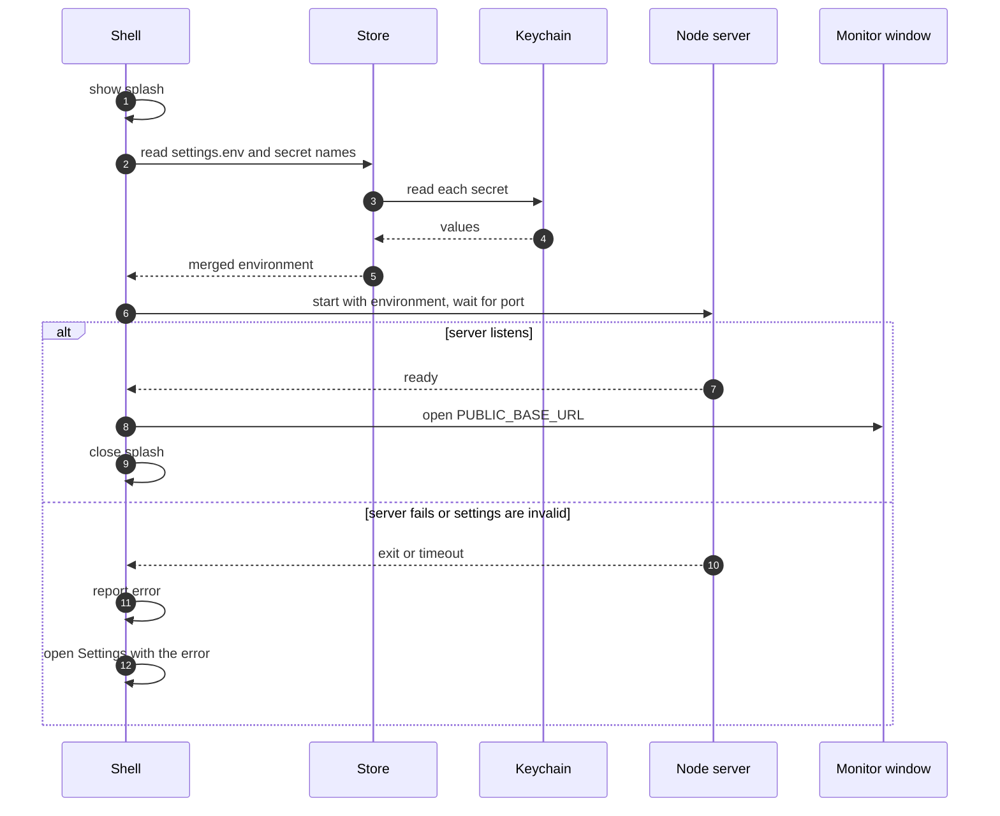
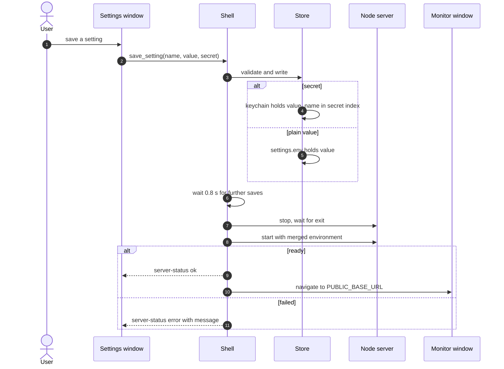

# Desktop app

The desktop app is the same server, packaged with the Tauri shell. The shell runs the bundled Node runtime on a fixed local port, then opens the monitor in a window. Settings are edited in their own window.

## Processes

- The **monitor window** is a remote page. It has no access to Tauri commands, so only the server's HTTP API is reachable from it.
- The **splash** and **Settings** windows are local pages. Only they can call the settings commands.
- The Node server exits when the app quits. It reads a pipe from the app, and the pipe closes when the app exits, for any reason.

## Start-up

## Changing a setting

Every save or removal applies the change. Edits made within about 0.8 seconds of each other apply once.

## Where each value lives

| Kind | Examples | Stored in | Shown in Settings as |
| --- | --- | --- | --- |
| Plain setting | `APIM_CHAT_URL`, `APPROVERS`, `PUBLIC_BASE_URL`, `PORT` | `settings.env` in the app data folder | its value |
| Secret | `ENTRA_CLIENT_SECRET`, `APIM_SUBSCRIPTION_KEY` | OS keychain, one item per name; names in `secret-names.txt` | "not set" or "stored in keychain", never the value |

A name lives in exactly one store. Saving it in one store removes it from the other.

## Rules for names and values

- Names use capital letters, digits and underscores, and start with a letter, like environment variables.
- Values are single-line. The settings file is line based.
- `settings.env` may be edited by hand. Secrets are never written to it.

## Limits

- Pending sign-in requests are kept in memory, so a reload asks users who are midway through sign-in to start again.
- Monitor runs in progress stop and resume after the restart.
- The keychain needs a running service on Linux: GNOME Keyring or KWallet through Secret Service.
- The desktop build needs Rust and, on Linux, WebKitGTK 4.1. See the Tauri prerequisites.
