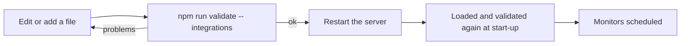
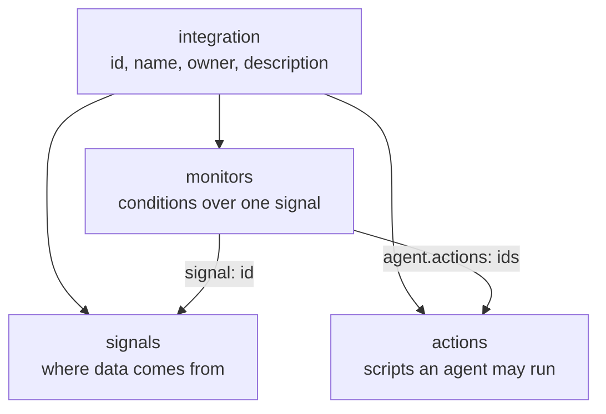

# Monitor configuration

Integrations and their monitors are plain files. Each integration is a folder with one `integration.yaml` (`.yml` and `.json` also work) and an optional `scripts/` folder for actions.

```
integrations/
  groups.yaml              optional: seeds groups in the database (see Groups)
  orders-api/
    integration.yaml
    scripts/
      fetch-failed-sample.ts
      reprocess-dlq.ts
```

A complete example ships in `examples/integrations/orders-api`.

## Lifecycle



Configuration is read once at start-up. Changing a file while the server runs has no effect until the next restart. Run the validator before restarting.

## Anatomy of an integration



Monitors reference signals and actions by `id`, so the ids must match. Ids must be unique within their integration. They are 2 to 63 characters: lowercase letters, digits and dashes, starting with a letter or digit.

## Signals

Every signal has an `id`, a `type` and an `intervalSec` (how often its monitors run). The `type` decides the other fields.

| `type` | Fields (defaults in brackets) | Default `intervalSec` | Metrics produced |
| --- | --- | --- | --- |
| `log-analytics` | `workspaceId`, `kql`, `windowMinutes` [5] | 300 | every numeric column the query returns, such as `serverErrors` |
| `app-insights` | same as `log-analytics` | 300 | same as `log-analytics` |
| `http-health` | `url`, `method` [`GET`, or `HEAD`], `expectStatus` [`[200]`], `timeoutMs` [5000] | 60 | `latencyMs`, `status`, and `healthy` (1 when the status is expected, else 0) |
| `storage-queue` | `accountUrl`, `queueName` (3 to 63 characters) | 120 | `depth`, the approximate message count |
| `service-bus` | `namespace`, `queueName` | 120 | `active`, `deadLetter`, `scheduled`, `total` |

Example:

```yaml
signals:
  - id: orders-5xx
    type: log-analytics
    workspaceId: ${LA_WORKSPACE_ID}
    windowMinutes: 5
    intervalSec: 300
    kql: |
      ApiManagementGatewayLogs
      | where ApiId == "orders"
      | summarize total = count(), serverErrors = countif(ResponseCode >= 500)
```

## Monitors

A monitor compares one metric from its signal with a threshold.

| Field | Required | Meaning |
| --- | --- | --- |
| `id` | yes | unique within the integration |
| `name` | yes | shown in the dashboard |
| `signal` | yes | the id of a signal in the same integration |
| `metric` | yes | the metric to compare, as the signal produces it |
| `operator` | yes | `gt`, `gte`, `lt`, `lte`, `eq` or `ne` |
| `threshold` | yes | number to compare against |
| `severity` | yes | `low`, `medium`, `high` or `critical` |
| `enabled` | no | default `true`; `false` keeps the monitor in the file without scheduling it |
| `tags` | no | up to 10 labels, each lowercase letters, digits and dashes, up to 32 characters. Used to filter the monitors page |
| `agent.maxSteps` | no | 1 to 30, default 8: the investigation's step limit |
| `agent.actions` | no | action ids the agent may use, default none |

Example:

```yaml
monitors:
  - id: orders-5xx-spike
    name: Orders 5xx spike
    signal: orders-5xx
    metric: serverErrors
    operator: gt
    threshold: 50
    severity: high
    agent:
      maxSteps: 8
      actions: [fetch-failed-sample, reprocess-dlq]
```

If a monitor's metric is missing from its signal's output, the tick fails with an error naming the metrics the signal did produce.

## Tags

Tags are labels for filtering. A monitor can carry several, and the monitors page offers a chip for each tag in use. Tags do not change how a monitor runs.

```yaml
monitors:
  - id: orders-down
    # ...
    tags: [orders, api, critical-path]
```

## Groups

A group brings monitors together, including monitors from different integrations. A monitor can belong to several groups.

Groups are stored in the database. The optional `groups.yaml` at the root of the integrations folder only seeds them: at start-up, each group whose `id` is not yet in the database is added. A group that already exists is left as it is, so edits made in the dashboard are kept, and changing `groups.yaml` later does not overwrite them. Approvers create, edit and delete groups in the Groups page; every change is recorded in the audit log.

```yaml
groups:
  - id: checkout
    name: Checkout
    owner: payments
    description: Everything a customer touches between cart and order confirmation.
    monitors: [orders-api/orders-down, orders-api/orders-5xx-spike]
```

| Field | Required | Meaning |
| --- | --- | --- |
| `id` | yes | unique across groups |
| `name` | yes | shown in the dashboard |
| `monitors` | yes | at least one `integration-id/monitor-id` |
| `owner`, `description` | no | shown in the dashboard |

Each member must name a monitor that exists, so a misspelled member fails validation in `groups.yaml`. In the dashboard, a member that does not exist is refused with the names of the unknown monitors. A group shows the number of open issues raised by its members and the most severe of them. Groups only summarise; they do not change how monitors are scheduled or approved.

## Actions

| Field | Required | Meaning |
| --- | --- | --- |
| `id` | yes | referenced from `agent.actions` |
| `description` | yes | what the action does, shown to the agent and the approver |
| `risk` | yes | `read` or `write` |
| `script` | yes | path relative to the integration folder |
| `requiresConfirmation` | write only | must be `true` for `write` |
| `timeoutSec` | no | script time limit; default 120 for `read` and 300 for `write` |

A `read` action runs without approval and is used for evidence. A `write` action only ever runs after an approver approves it.

## Replacing or removing a monitor

| Change | Steps | Effect on existing issues |
| --- | --- | --- |
| Change a threshold or interval | edit, validate, restart | none |
| Disable a monitor | set `enabled: false`, restart | open findings stay open |
| Replace a monitor | edit its id, name, metric or signal, restart | findings from the old monitor id stay in the database; update `groups.yaml` too if the id changed |
| Remove a monitor | delete its entry, restart | findings stay; no new ones are opened |
| Add an integration | add a folder with `integration.yaml`, validate, restart | none |

Findings are stored with the monitor id, so renaming a monitor leaves its old findings under the old id. Resolve them in the dashboard if they are no longer relevant.

## Environment variables

Use `${NAME}` anywhere in the YAML. Values come from the server's environment. On the desktop they come from the Settings window, and secrets come from the keychain. A missing variable is a validation error that names the file.

## Validating

```bash
npm run validate -- integrations
```

The validator checks the schemas, that every `${NAME}` is set, that every script exists, and that ids are unique. It exits with an error and lists every problem it finds, so you can fix them in one pass.
