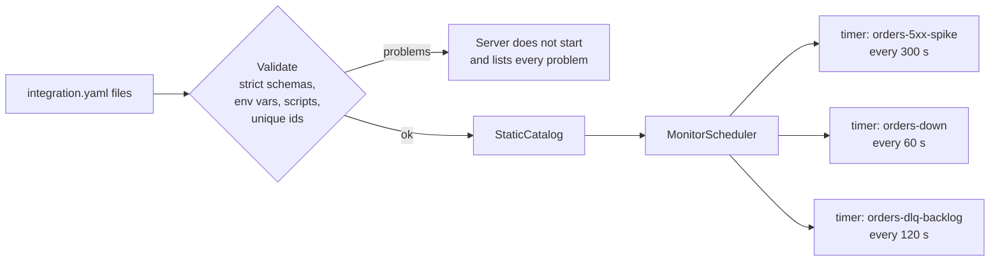
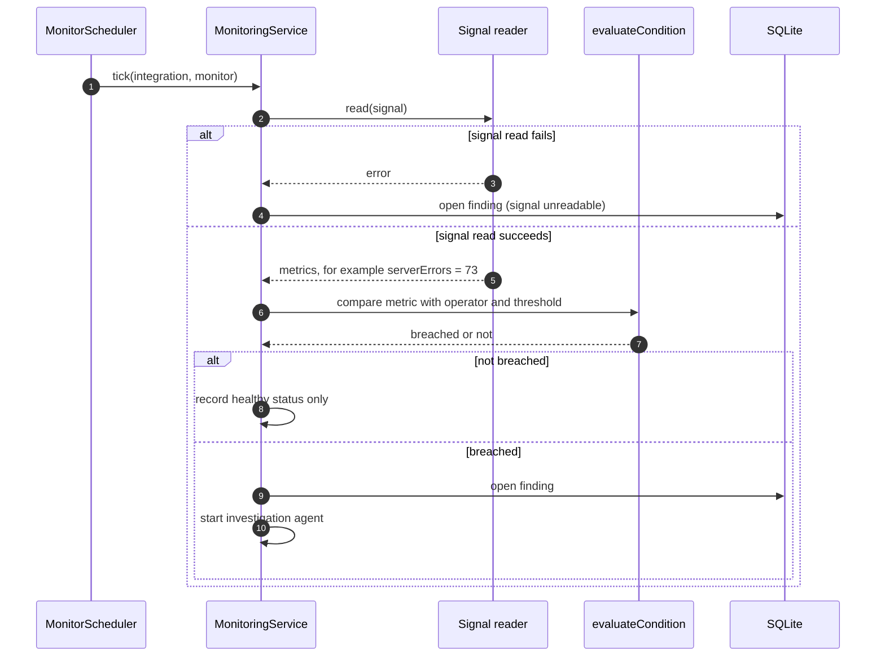
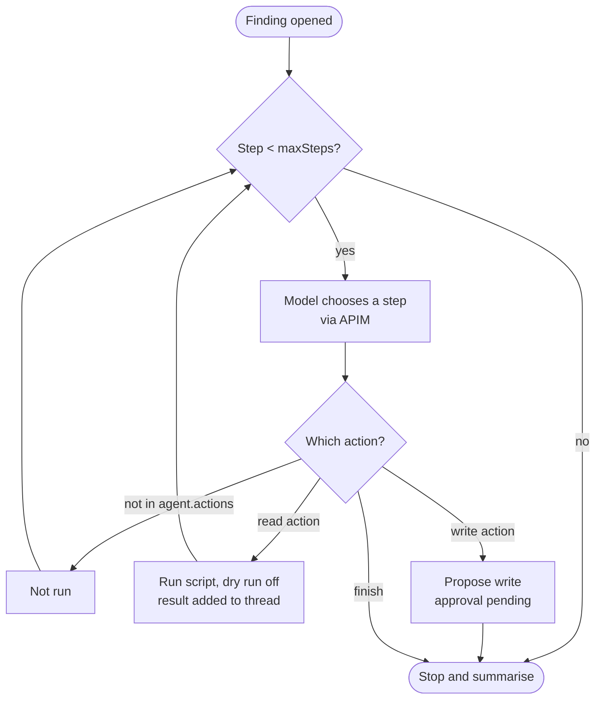
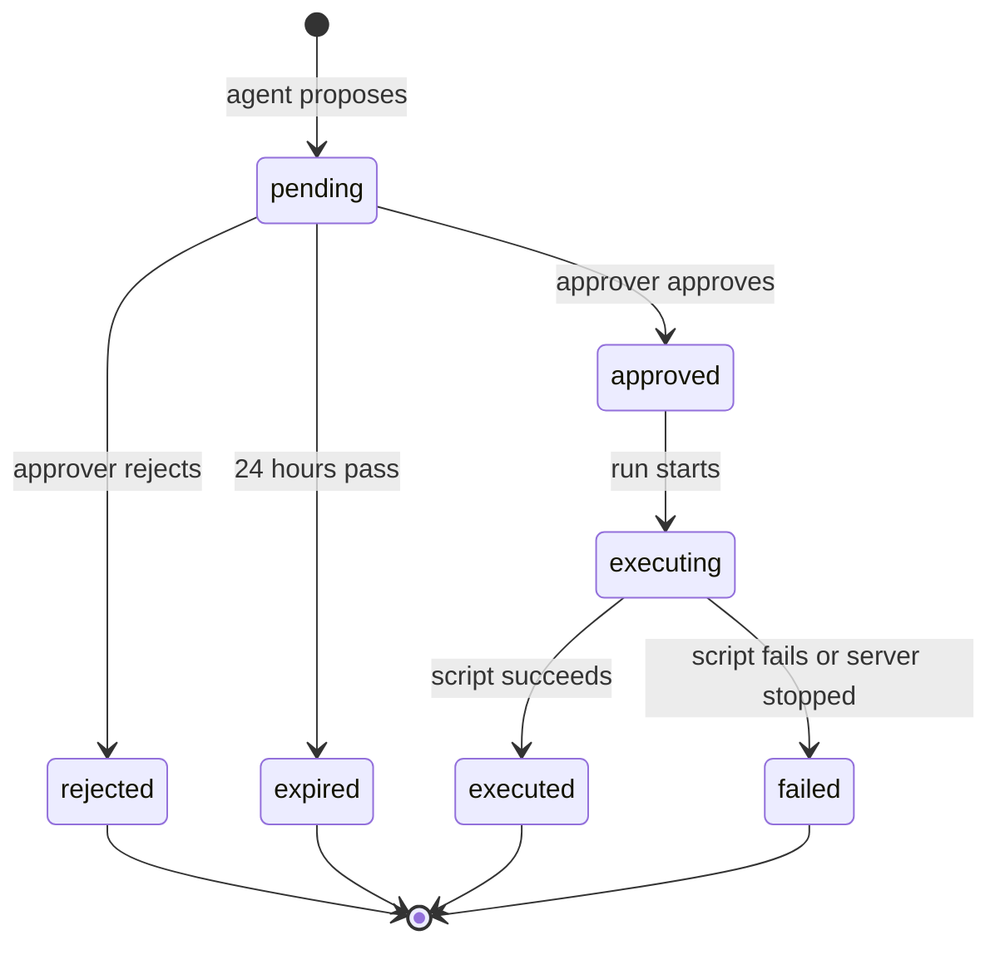
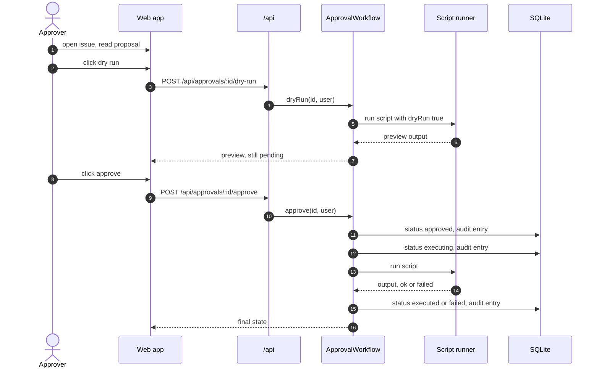

# Monitoring flow

This document follows one monitor from its scheduled check to an executed action.

## 1. From configuration to timers

At start-up the server loads every `integrations/<id>/integration.yaml`, validates it, and starts one timer per enabled monitor. The timer interval is the `intervalSec` of the monitor's signal.

Disabled monitors (`enabled: false`) get no timer.

## 2. One tick

Each tick reads the signal, evaluates the monitor's condition, and records the result.

A healthy monitor only records its status. A breach or an unreadable signal opens a finding and starts the agent. If the tick itself throws, the monitor's status becomes `error` and a `monitor.error` entry is written to the audit log.

## 3. Investigation

The agent is a bounded loop. It can read evidence, and it can propose writes. It cannot run writes itself.

The agent may only use the actions listed under `agent.actions` for its monitor. Every step and result is posted to the finding's thread.

## 4. Approval

A proposed write waits for a named approver. The state machine lives in `src/domain/approval.ts`, and every transition is applied by the `ApprovalWorkflow`.

Rules that hold at every step:

- Only an approver (see `APPROVERS`) can approve, reject, dry-run or resolve. Everyone signed in can view.
- A dry run previews the action in dry mode and leaves the approval pending.
- Only the `approved` to `executing` transition starts a write. It runs once.
- An approval left in `executing` when the server stops is marked `failed` at the next start for review. It is never retried automatically.

The sequence for an approval:

Each arrow that changes state writes its audit entry in the same transaction. A non-approver receives a 403 at the approve step, before anything runs.
