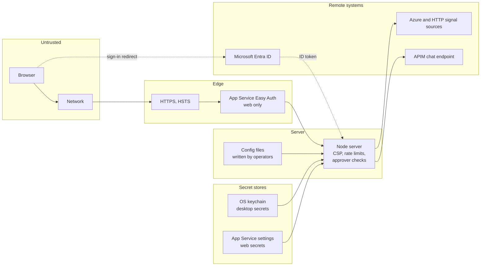
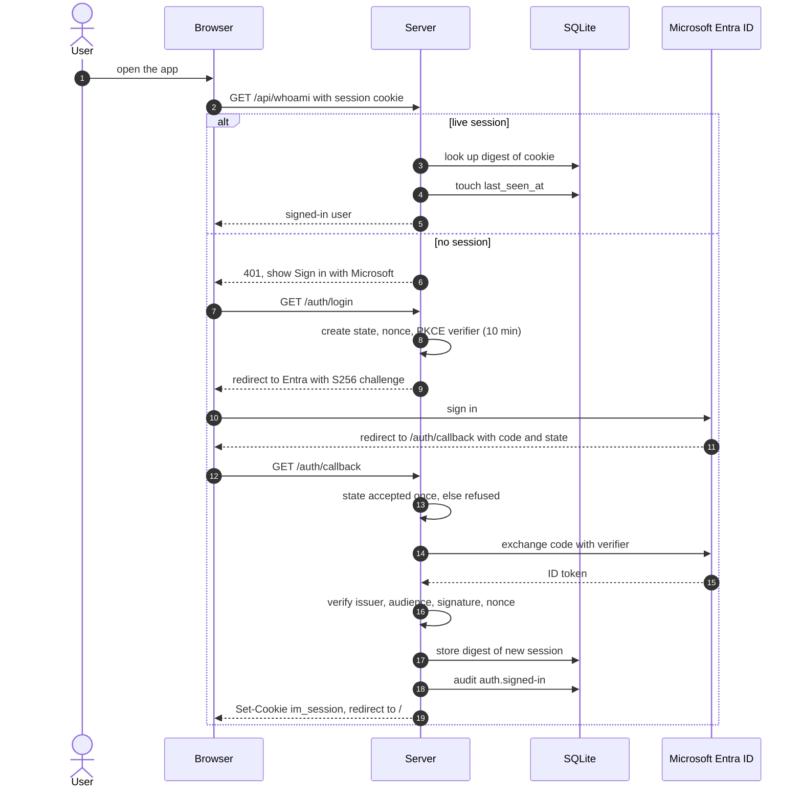
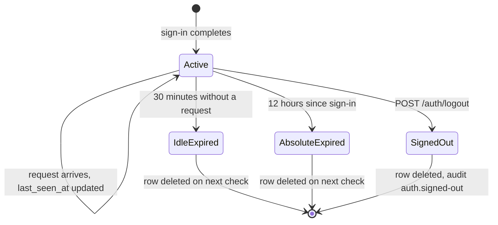
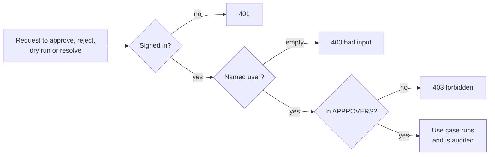

# Security and sign-in

The full mapping of OWASP Top 10 controls is in the [top-level README](../README.md#security-controls-owasp-top-10-2021). This document covers how sign-in and sessions work, and where the trust boundaries are.

## Trust boundaries

Three rules follow from the boundaries:

- Anything a browser sends is checked on the server. Hiding a button is never the only control.
- The server trusts the identity header only when App Service sits in front of it. Make sure nothing else can reach the container.
- Config files are written by operators, so signal URLs are trusted input. Users cannot enter URLs through the UI.

## Sign-in

Sign-in uses OpenID Connect with the authorization code flow and PKCE. The server checks for an existing session first, so a returning user is not asked to sign in again.

Failures give generic messages. A provider outage returns 503 with no internal detail. A replayed or forged state is refused and audited as `auth.refused`.

## Session lifecycle

A session ends in one of three ways: it sits idle for 30 minutes, it reaches 12 hours since sign-in, or the user signs out.

Cookies are HttpOnly and SameSite=Lax. On https the name is `__Host-im_session`, which requires Secure, Path=/ and no Domain. The database stores only a SHA-256 digest of the cookie value, so a leaked database does not reveal live sessions.

## Authorization

Every state change goes through an approver check in the use case:

Viewing the dashboard is open to everyone who is signed in. Changing anything requires being listed in `APPROVERS`. The list is required in `entra` and `easy-auth` modes, so the server will not start without it.

## Audit events

| Event | When |
| --- | --- |
| `auth.signed-in` | sign-in completes |
| `auth.refused` | a sign-in response is refused |
| `auth.signed-out` | the user signs out |
| `finding.opened` | a breach or unreadable signal opens an issue |
| `finding.resolved` | an issue is closed |
| `monitor.error` | a tick itself throws |
| `approval.requested` | the agent proposes a write |
| `approval.dry_run` | a dry run is previewed |
| `approval.approved`, `approval.rejected`, `approval.expired` | the approver decides, or the proposal times out |
| `approval.executing`, `approval.executed`, `approval.failed` | the write runs, and its outcome |

Entries are append-only and are shown in the dashboard's audit view.
